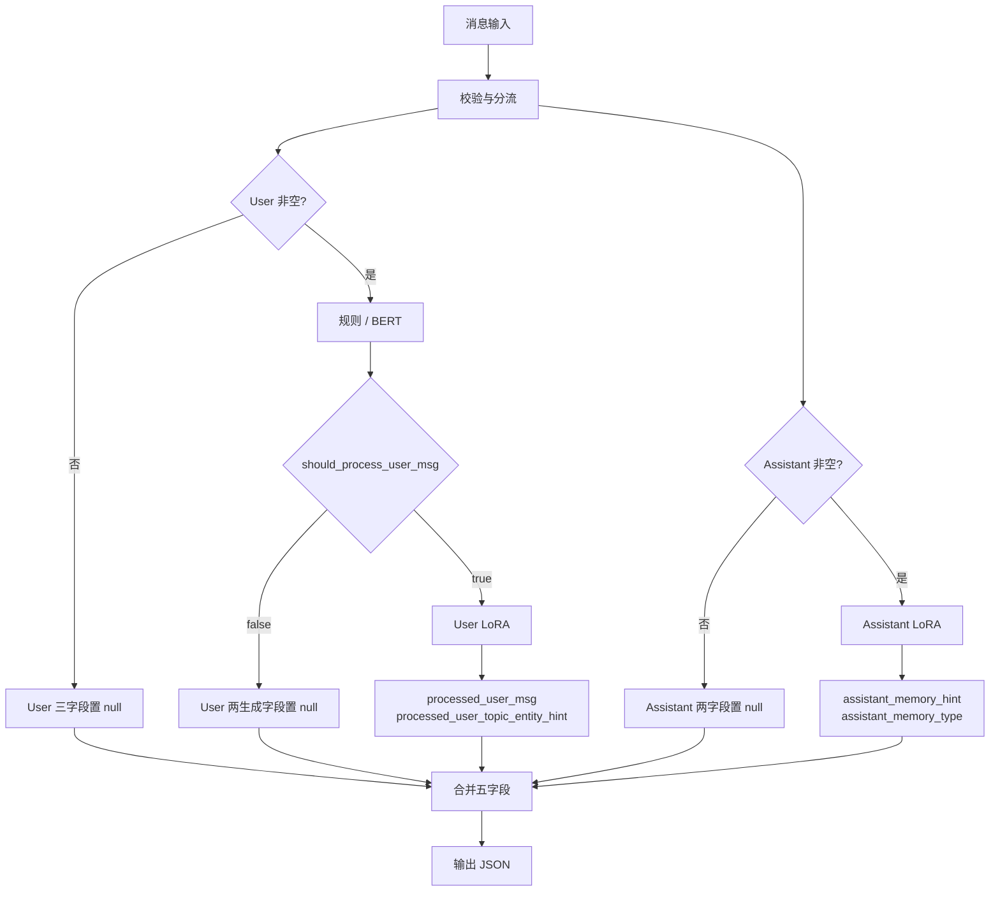
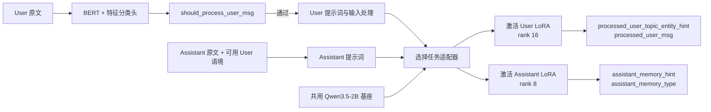
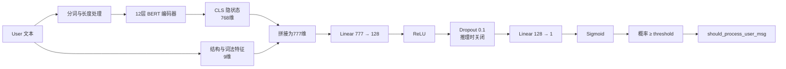

# Extract Pruning

**面向对话记忆的本地消息规整与摘要组件。** 接收 User / Assistant 消息，返回固定五字段 JSON，用于记忆写入预处理、内容归档和后续检索。

项目采用 **BERT 门控 + 一份 Qwen3.5-2B 基座 + 两个 LoRA 适配器**，提供 Python 接口、单样本 JSON 推理和支持断点续跑的批量 JSONL 推理。权重准备完成后，推理不依赖在线大模型 API。

## 1. 项目背景与功能

对话消息中经常混有用户请求、复制的文章、业务 JSON、客服对话和文件摘要。直接把全部内容存入记忆，会增加存储和检索负担；简单截断又可能丢失关键请求、数字、条件和人物关系。Assistant 的长回复也需要转换成适合后续使用的摘要。

本项目分别处理两侧消息：

- **User 侧**：判断是否需要规整；需要时生成融合后的短文本，并提取被处理对象的主题或实体名称。
- **Assistant 侧**：将非空回复概括为动作摘要，同时输出一个主要回应类型。
- **统一接口**：把两个模型任务的结果合并为五个固定字段，供下游业务使用。

典型用途包括对话记忆写入预处理、摘要归档、按回应动作组织内容，以及生成向量检索所需的主题锚点。项目提供预处理结果，**不包含数据库写入、向量索引、记忆去重或检索服务**。

`should_process_user_msg=false` 表示无需进行本项目的 User 规整，不表示应删除该消息；调用方可以按业务规则保留原文。

## 2. 输入与输出

### 2.1 输入结构

输入是一个仅包含 `msgs` 的 JSON 对象：

```json
{
  "msgs": [
    {"role": "User", "msg": "用户消息"},
    {"role": "Assistant", "msg": "助手回复"}
  ]
}
```

| 字段 | 类型 | 约束 |
|---|---|---|
| `msgs` | array | 零至两条消息，每种角色最多一条 |
| `role` | string | 只接受 User、Assistant，大小写不敏感，顺序不限 |
| `msg` | string / null | null、空字符串和纯空白均视为空 |

缺失的一侧按空消息处理。重复角色、未知角色、额外字段或非字符串正文会被拒绝。多个历史轮次需由调用方先组织成当前请求，组件不会自动猜测配对关系。

**路由只依据外层 role。** 正文中的“用户:”“客服:”或嵌套对话标签是待处理内容，不会成为额外请求。

文件内容需由上游转换成文本摘要，再放入 `<input-file-summary>...</input-file-summary>` 等文本包装。本接口不直接读取图片、视频、PDF或文件路径。

### 2.2 五个输出字段

成功返回时始终包含五个字段，空值为真正的 JSON `null`，不是字符串 `"null"`：

| 字段 | 类型 | 含义 |
|---|---|---|
| `assistant_memory_hint` | string / null | Assistant 动作摘要，目标是保留具体对象、问题、选项和条件 |
| `assistant_memory_type` | string / null | Assistant 的主要回应类型，取九类之一 |
| `should_process_user_msg` | boolean / null | 是否需要生成 User 规整结果；User 为空时为 null |
| `processed_user_msg` | string / null | User 规整文本，目标是保留真实表达、概括外部材料并区分来源 |
| `processed_user_topic_entity_hint` | string / null | 本次被处理对象的主题/实体名称，如“西红柿炒鸡蛋食谱” |

主题锚点是一个简短名称，不是实体列表或向量。后续 embedding 和数据库连接由调用方完成。

### 2.3 Assistant 九分类

| 类别 | 含义 |
|---|---|
| `comfort` | 安慰、情绪支持 |
| `suggestion` | 一般行动建议 |
| `recommendation` | 推荐具体方案、产品或对象 |
| `warning` | 风险、限制或后果提醒 |
| `instruction` | 操作步骤、执行方法 |
| `question` | 询问、追问或澄清 |
| `agreement` | 认同或附和 |
| `repetition` | 主要重复用户已有内容 |
| `other` | 其他有效回应 |

每条回复只选择一个主要类型，摘要可以保留多个动作。类别由模型结合语义生成，不按问号或关键词直接分类。

### 2.4 完整示例

以下是项目端到端自测中的一个双侧请求。

**输入：**

```json
{
  "msgs": [
    {
      "role": "User",
      "msg": "请记住这个食谱。<input-file-summary>西红柿炒鸡蛋：3个鸡蛋、2个西红柿，先炒蛋盛出，再炒西红柿，最后混合。</input-file-summary>"
    },
    {"role": "Assistant", "msg": "请问您需要修改文章，还是总结文章？"}
  ]
}
```

**实际输出：**

```json
{
  "assistant_memory_hint": "询问用户是否需要修改文章或总结文章。",
  "assistant_memory_type": "question",
  "should_process_user_msg": true,
  "processed_user_msg": "我说了请记住这个食谱。我复制了一段关于西红柿炒鸡蛋的食谱，包含3个鸡蛋、2个西红柿，以及先炒蛋盛出、再炒西红柿、最后混合的步骤。",
  "processed_user_topic_entity_hint": "西红柿炒鸡蛋食谱"
}
```

此例也展示了两侧独立性：Assistant 的文章处理问题不会写入 User 食谱摘要。示例是实际模型输出，不是语义正确性的保证；具体措辞可能随运行环境变化。

仅有User且门控不通过时，输出形态为：

```json
{
  "assistant_memory_hint": null,
  "assistant_memory_type": null,
  "should_process_user_msg": false,
  "processed_user_msg": null,
  "processed_user_topic_entity_hint": null
}
```

### 2.5 空值与失败约定

| 请求状态 | Assistant 两字段 | User 门控 | User 另外两字段 |
|---|---|---|---|
| 两侧均空 | null | null | null |
| 仅 Assistant 非空 | 模型生成 | null | null |
| 仅 User 非空、门控 false | null | false | null |
| 仅 User 非空、门控 true | null | true | 模型生成 |
| 两侧非空 | 模型生成 | true 或 false | 根据门控生成或置 null |

**生成失败不是空值场景。** 格式错误、非法类别、空生成字段或长度异常会报错，不会返回伪造的五字段成功结果。

## 3. 数据处理流程



图中的分支表示业务逻辑，不表示GPU并行执行。实现先计算User门控，再按需执行Assistant和User生成。同一请求最多调用两次Qwen；门控为false时省去User生成。

完整配对的 `<input-file-summary>...</input-file-summary>` 按规则直接通过门控；标签损坏等情况交给BERT判断。此规则只识别文本包装形式，不验证摘要内容的真实性。

## 4. 模型结构

### 4.1 组件与共享方式



| 组件 | 作用 | 权重目录 |
|---|---|---|
| BERT 门控 | 判断非空User是否需要规整 | `model/bert/` |
| Qwen3.5-2B | 两侧共用的语义生成基座 | `model/qwen_base/` |
| Assistant LoRA | 生成Assistant摘要和类型 | `model/assistant_lora/` |
| User LoRA | 生成User规整文本和对象锚点 | `model/user_lora/` |

同一个 `ExtractPruning` 实例只加载一份Qwen基座，同时挂载两个适配器，每次生成只激活其中一个。LoRA是模型内部线性层的参数增量，不是仅接在末端的分类头。本实现不把两个LoRA叠加合并。

### 4.2 BERT 门控网络

门控使用中文BERT编码器与文本结构特征联合二分类。随附配置为12层、隐藏维度768、12个注意力头、最大位置长度512。



九维特征分别为：代码块数量、表格行数量、引用行数量、URL数量、处理意图词得分、内容边界词数量、第一人称占比、段落数量、文本长度。计数按实现中的上限归一化。

普通消息采用 `sigmoid(logit) >= threshold` 判为true，默认阈值0.5。输入超过编码容量时，保留头部和尾部，并对中间token均匀采样；结构特征仍从完整原文提取。这种编码不等于完整长文理解。

`best.safetensors` 包含微调后的编码器和分类头完整权重。`tokenizer/` 提供分词器及BERT架构配置，无需再加载一份BERT基座权重。配置文件中保留的 `BertForMaskedLM` 元数据不代表实际使用掩码语言模型输出头：运行代码使用 `AutoModel` 编码器与自定义二分类头。

### 4.3 Qwen 基座与 LoRA 结构

随附Qwen3.5-2B的文本配置为24层、隐藏维度2048、MLP中间维度6144。其层类型由18个线性注意力层和6个全注意力层组成，每4层包含一个全注意力层；全注意力配置包含8个查询头和2个键值头。

项目通过 `Qwen3_5ForConditionalGeneration` 加载完整基座，但当前仅进行文本推理。基座包含视觉组件不意味着本接口已经提供图像或视频处理能力。

LoRA向线性变换加入低秩增量：

```text
有效权重 = 冻结基座权重 W + (alpha / rank) × B × A
```

两个适配器作用于语言模型的注意力投影和MLP投影，共186个目标模块，不向视觉组件添加LoRA。

| 适配器 | rank | alpha | LoRA参数量 | 同次生成字段 |
|---|---:|---:|---:|---|
| Assistant | 8 | 16 | 8,409,600 | 动作摘要、主要动作类型 |
| User | 16 | 32 | 16,819,200 | 主题实体锚点、规整文本 |

推理时所有参数冻结，使用非思考聊天模板和 `do_sample=false`。共享基座减少重复加载的权重内存，但仍需分别计算两侧任务。

### 4.4 任务输入与内部生成格式

**Assistant路径**：把两个消息槽序列化为JSON，与Assistant系统提示词一起输入模型。User用于必要的语境理解。模型内部生成hint/type两字段JSON，解析器检查非空摘要及合法类别。

**User路径**：默认只使用User正文，不附加Assistant。预处理调整字面转义和空白；超过512 token时按保头75%、保尾25%的预算策略截断，并加入中间截断标记。标记也占用预算，重新分词后可能存在少量长度差异。

User内部输出为：

```text
主题实体锚点<|field_sep|>规整文本
```

解析器要求恰好一个分隔符且两侧非空，然后转换成外部JSON。业务方无需自行解析此分隔符。

## 5. 项目目录与权重准备

```text
extract_pruning/
├── model/
│   ├── bert/
│   │   ├── best.safetensors
│   │   ├── config.json
│   │   └── tokenizer/
│   ├── qwen_base/                 # 完整基座、分词器、模型配置
│   ├── assistant_lora/            # adapter_config.json + adapter_model.safetensors
│   └── user_lora/                 # adapter_config.json + adapter_model.safetensors
├── prompts/
│   ├── assistant_prompt.txt
│   └── user_prompt.txt
├── config.json
├── pipeline.py                    # Python复用接口
├── predict.py                     # 单JSON入口
├── batch_predict.py               # JSONL批量入口
├── gate_runtime.py                # 门控网络、特征与编码
├── user_runtime.py                # User输入处理和生成解析
├── sample_oss.py                   # 可选快照抽样工具
├── input_sample.json
├── output_sample.json
├── input_batch.jsonl
├── output_batch.jsonl
├── test_pipeline.py
├── test_batch.py
├── smoke_test.py
├── model_manifest.json
├── requirements.txt
└── README.md
```

运行前需取得匹配的基座、BERT、两个LoRA及提示词，并按上述目录放置。**代码与权重包可以分开分发，克隆代码不代表已经取得权重。** 本文档不提供尚未发布的下载地址。当前完整随附文件约5.08 GB（十进制），主要为基座权重。

模型和提示词路径相对 `config.json` 所在目录解析，也可配置部署环境中的绝对路径。适配器配置里的历史 `base_model_name_or_path` 是元数据，程序显式加载config指定的基座，不访问历史服务器。

模型加载使用 `local_files_only=True`，不会联网补齐缺失文件。正常推理不依赖OSS、训练数据、优化器状态或原训练目录。

## 6. 安装与使用

### 6.1 环境准备

使用Python 3.10或更新的兼容版本。已验证主要依赖组合：PyTorch 2.9.0、Transformers 5.15.0、PEFT 0.20.0、Accelerate 1.14.0。

在项目目录创建虚拟环境：

```bash
python -m venv .venv
```

Linux / macOS激活：

```bash
source .venv/bin/activate
```

Windows PowerShell激活：

```powershell
.venv\Scripts\Activate.ps1
```

先按设备安装合适的PyTorch构建，再安装其余依赖：

```bash
# 需要CUDA时，应安装与GPU驱动兼容的PyTorch CUDA构建。
# 已有适用的PyTorch环境时无需重复安装。
python -m pip install torch==2.9.0
python -m pip install -r requirements.txt
```

通用pip命令是否提供所需CUDA构建取决于平台和软件源。运行GPU推理前确认CUDA可用：

```bash
python -c "import torch; print(torch.__version__); print(torch.cuda.is_available())"
```

Qwen默认优先使用CUDA；不可用时使用CPU float32，速度更慢且主内存需求更大。`auto` 不会自动选择MPS或多卡分片。BERT默认使用CPU。显存需求随输入长度、输出长度和精度变化，不保证任意输入都能在固定显存容量内运行。

### 6.2 单样本推理

```bash
python predict.py --input input_sample.json --output result.json
```

需要独立诊断信息时：

```bash
python predict.py --input input_sample.json --output result.json --diagnostics diagnostics.json
```

- 输入文件支持UTF-8及UTF-8 BOM。
- 省略 `--input` 时从stdin读取一个JSON对象。
- 省略 `--output` 时业务JSON写入stdout，日志与错误写入stderr。
- 诊断文件记录门控概率/规则路径、token数量和截断信息，不混入业务JSON。
- 成功退出码0，失败1；失败不写新的成功结果。若目标文件此前存在，它仍是旧结果，应以退出码判断本次是否成功。

### 6.3 Python 应用集成

在项目目录运行，或将项目目录加入应用模块搜索路径：

```python
from pipeline import ExtractPruning

engine = ExtractPruning("config.json")
result = engine.predict({
    "msgs": [
        {"role": "User", "msg": "用户消息"},
        {"role": "Assistant", "msg": "助手回复"},
    ]
})

# 复用同一实例处理后续请求，可选择返回独立诊断信息。
result, diagnostics = engine.predict_with_diagnostics({
    "msgs": [{"role": "User", "msg": "另一条用户消息"}]
})
```

应复用同一个engine。模型按需延迟加载，第一次调用包含加载开销。实例内部用请求锁保护适配器切换，因此同一实例串行处理请求。多个实例或进程各自加载模型，不能视为共享一份显存。

当前提供Python组件和命令行工具，未内置HTTP服务、GPU动态批处理或分布式调度。

### 6.4 批量 JSONL 推理

输入文件每行一个完整请求，不是外层JSON数组：

```jsonl
{"msgs":[{"role":"User","msg":"你好"},{"role":"Assistant","msg":""}]}
{"msgs":[{"role":"User","msg":""},{"role":"Assistant","msg":"请问您希望修改文章还是总结文章？"}]}
```

```bash
python batch_predict.py --input input_batch.jsonl --output batch_results.jsonl
```

输出第N行对应输入第N行，每行只含五个业务字段。批量入口复用一个模型实例、按条串行生成；文件批量处理不等于GPU张量批处理。

| 文件 | 内容 |
|---|---|
| `batch_results.jsonl` | 逐行五字段结果 |
| `batch_results.run.json` | 状态、完成行数、输入/代码/模型指纹 |
| `batch_results.diagnostics.jsonl` | 每行耗时、门控及生成诊断 |

空白行、非法JSON或错误结构在推理前报错。每完成一条立即刷新输出并打印进度。模型异常时停在失败行，不跳过样本，不输出伪造的null成功结果。

断点续跑：

```bash
python batch_predict.py --input input_batch.jsonl --output batch_results.jsonl --resume
```

恢复时检查输入、配置、代码、提示词和模型是否变化。已有输出默认禁止覆盖；独立重跑请更换输出路径。`status=complete` 且输入输出行数一致，表示整批完成。

### 6.5 可选：从自有 OSS 快照抽样

核心入口接受任何符合接口规范的JSONL，不要求来自OSS。抽样工具仅适用于本项目快照结构：

```bash
python sample_oss.py --source /path/to/oss_data.jsonl --output sampled_inputs.jsonl --count 100 --seed 42
```

工具读取外层payload数组中的 `source=llm`、`type=user_pruning/assistant_pruning` 记录，只提取input。完整输入去重后随机抽样，再按源位置排序；不会复制监督标签或跨记录配对消息。来源行号保存在 `.sources.json`。

## 7. 配置说明

配置入口为 [config.json](config.json)。

| 参数 | 默认值 | 作用 |
|---|---|---|
| `base_model` | `model/qwen_base` | 共用基座路径 |
| `runtime.device` | `auto` | Qwen设备，可明确设置cpu/cuda |
| `runtime.dtype` | `bfloat16` | CUDA精度；CPU实际使用float32 |
| `runtime.attention_implementation` | `sdpa` | 注意力实现 |
| `gate.weights` | `model/bert/best.safetensors` | 门控权重 |
| `gate.device` | `cpu` | 门控设备 |
| `gate.threshold` | `0.5` | 放行阈值，范围0～1 |
| `gate.max_length` | `512` | BERT编码长度，范围8～512 |
| `assistant.adapter` / `user.adapter` | 对应model子目录 | 两侧适配器路径 |
| `assistant.prompt` / `user.prompt` | 对应prompts文件 | 两侧提示词 |
| `assistant.max_seq_length` | `6144` | 输入加生成预留预算的上限 |
| `assistant.max_new_tokens` | `512` | Assistant最多生成token数 |
| `user.max_seq_length` | `3072` | 输入加生成预留预算的上限 |
| `user.max_new_tokens` | `384` | User最多生成token数 |
| `user.input.budget` | `512` | 默认User正文预算 |
| `user.input.head_ratio` | `0.75` | 超长User可用保留预算中头部比例 |
| `user.input.use_assistant_note` | `false` | 是否附加Assistant尾注 |
| `user.input.assistant_note_budget` | `128` | 开启尾注时的尾注预算 |
| `user.input.user_budget_with_note` | `384` | 开启尾注时的User预算 |

降低门控阈值会增加或保持放行数量，但不保证提升整体质量。修改提示词、输入预算和尾注开关后，也应重新验证语义质量及资源需求。LoRA的rank/alpha是权重结构的一部分，不能通过修改推理配置把rank=8权重变成rank=16权重。

## 8. 测试与已验证行为

不加载模型的接口测试：

```bash
python test_pipeline.py
python test_batch.py
```

真实权重自测：

```bash
python smoke_test.py
```

自测重新生成 `output_sample.json`、`smoke_test_results.json`，覆盖空输入、短User、Assistant-only、文件摘要规则、双侧生成及适配器切换一致性。

随附100条批量功能测试已完成，来源映射、字段结构与路由空值规则均通过检查。样本覆盖User-only 79条、Assistant-only 12条、双侧9条；User门控通过11条、未通过77条、User为空12条，Assistant生成21条。

这些结果证明端到端接口可运行，**不构成独立泛化准确率或跨硬件性能基准**。快照样本可能与训练数据重合。结果核验见 `batch_verification.json` 和 `smoke_test_results.json`，权重复制校验见 `model_manifest.json`。

## 9. 已知边界

- **语义保真需要验收**：格式合法、语句通顺不保证数字、条件、指代与来源归属全部正确；字面相似度也不是语义准确率。
- **长输入存在信息损失**：User采用中间截断，BERT采用采样编码。Assistant超过输入加输出预算时直接报错。
- **清洗可能改变代码或转义文本**：User预处理会调整空白、代码缩进和字面转义，代码类内容需单独验收。
- **语言与领域覆盖有限**：门控和LoRA在新语言、新业务上的效果需要单独验证，文件摘要规则通过不等于内容理解正确。
- **错误明确暴露**：解析失败、非法类别、空字段或达到生成上限会报错，当前没有自动重试或远程API回退。
- **共享基座不等于并行服务**：单实例串行处理，未实现多GPU切分或多请求动态批处理。

接入业务时应保留原始消息，把五字段作为派生结果使用，并依据实际用途验收关键事实和主题对象的保留情况。
